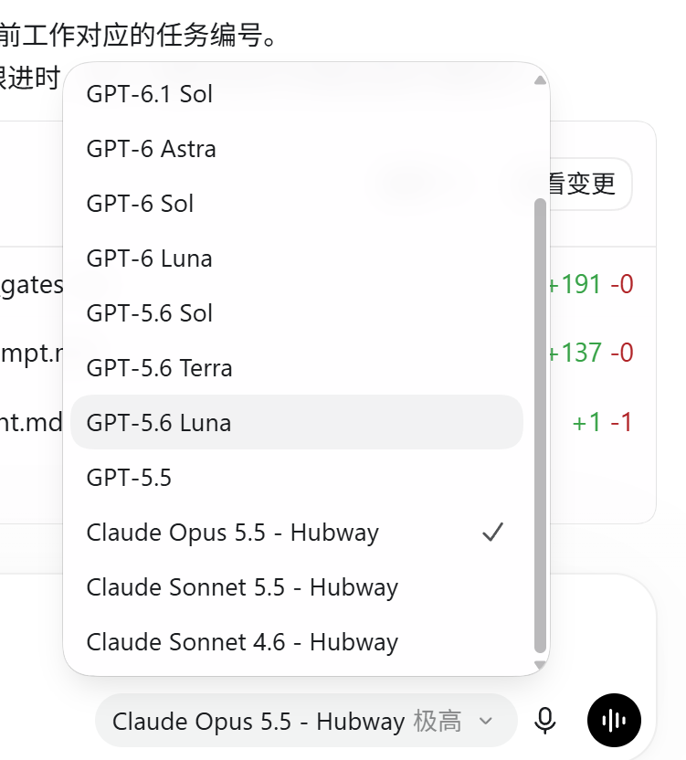

# Codex custom model menu patch

[中文](README.md) · [Installation notes](docs/INSTALLATION.md) · [Output budget findings](docs/OUTPUT_BUDGET.md) · [Architecture](docs/ARCHITECTURE.md) · [MIT](LICENSE)

This is a derivative of the extension edition of [limyum-creator/codex-deepseek-patch](https://github.com/limyum-creator/codex-deepseek-patch). It merges compatible third-party models into the Codex desktop model picker while keeping official GPT models and their existing authentication. Each model slug remains unchanged and is explicitly routed to its provider in the generated catalog. Merely adding a model_providers entry to config.toml does not create a combined desktop menu.

## Final result

The Codex desktop model picker shows official GPT models alongside the Claude models added by this patch, with both available for selection. This screenshot is from the installed local build:



Requirements: Python 3.11+, Codex desktop, and a service with /v1/models and a compatible Responses API. Supply your own URL, model IDs, and accurate context limits. Set the API key in an operating-system environment variable; never commit it or put it in the connection JSON or config.toml.

```powershell
git clone https://github.com/xdzhu/codex-model-customize-patch.git
cd codex-model-customize-patch
[Environment]::SetEnvironmentVariable('THIRD_PARTY_API_KEY', '<your-key>', 'User')
```

Reopen PowerShell after setting the variable. Typing a real key in a command can leave it in shell history; use an interactive secret prompt or a credential manager when possible.

```powershell
python patch.py connect --name example --kind openai --url https://api.example.com/v1 --wire-api responses --env-key THIRD_PARTY_API_KEY --models MODEL_SLUG --context-window 200000
python patch.py build --connections "<path-to-connections.json>" --output "<path-to-build-directory>" --verify
```

connect prints the location of the locally saved connection file. For several models with distinct specifications, edit its model_specs using [the example](examples/connections.example.json). Close Codex normally before installing:

A keyless [USTC five-model example](examples/ustc-connections.example.json) shows the selected DeepSeek, GLM, and Qwen IDs. All five passed short Responses and function-call checks with the user's authorized key; see the [validation notes](docs/INSTALLATION.md#中科大平台五模型接入验证). The example stores only the `USTC_API_KEY` environment variable name. Merge multiple services into the `locals` array of one private connections file.

The USTC example exposes `medium/high` for all five models and `xhigh` for `qwen3.8-flash-next`, with `high` as the default. Short streaming requests confirmed that the gateway echoed these levels. For the other four models, an `xhigh` request returned HTTP 200 but the response reported `high`, so the menu does not advertise an ineffective `xhigh` option. An older catalog with no declared levels displayed “Medium” in the desktop menu while the recorded turns used `none`; verify the actual turn effort and provider response rather than inferring it from that label.

The example also declares image input for `deepseek-flash`, `glm-5.3-flash`, and `qwen3.8-reasoner`. Each correctly identified a synthetic red PNG in a short Responses request. The older catalog marked all five as text-only, causing the desktop app to block image attachments before sending them. `deepseek-v4-flash` returned an error within the stream for the image request, and `qwen3.8-flash-next` produced no answer, so both remain text-only in the example.

External catalog entries now replace the official GPT identity sentence copied by the template. The official entries remain unchanged. In one model-switching chat, the recorded model IDs were GLM, DeepSeek, and Qwen despite misleading GPT self-identification; two DeepSeek turns received upstream HTTP 400. A controlled replay identified the exact defect: a visible GLM reasoning summary was converted into an assistant message without `type: "message"`. The provider rejected that historical input; the complete replay returned HTTP 200 after the field was added. See the [incident record](docs/INSTALLATION.md#多模型会话的错误身份与-http-400).

```powershell
python patch.py install "<path-to-build-directory>"
```

Reopen Codex and use the model picker. Official models remain available. To undo, close Codex and run python patch.py restore "<path-to-build-directory>".

On Windows, the installer registers a logon scheduled task to start the local adapter after a reboot and sign-in. Keep the API key in a persistent user environment variable; no terminal or manual script is needed on each startup. The official GPT login and models remain available.

The installed adapter does not require an exact Codex desktop version. After an app update, check the model menu, `patch.py status`, and a short request. Rebuild and run isolated verification against the current signed app when the request contract changes, the catalog needs refreshing, or a new build is to be installed. This fork has no configured automatic update feed; do not enable the background update monitor. Quit Codex normally before installing a new build. This adapter handles model traffic, so inspect the source before use. Local build output and connection files can contain sensitive operational data and must stay out of Git.

The updated example lists Opus 5.5, Sonnet 5.5, and Sonnet 4.6 in menu order. A minimal Responses request to Sonnet 5.5 returned `42`, and an incremental catalog build passed isolated verification. A later build with long-history recovery fixes was installed locally. For the tested Opus 5.5 route, short requests established an accepted `max_output_tokens` ceiling of 128000; see the [output budget findings](docs/OUTPUT_BUDGET.md) for evidence and limits. The example context limits are placeholders; use values verified with your provider.

Switching an old GPT chat to Opus may trigger costly history recovery before the final request, which can still be rejected with HTTP 400. A fresh chat with a concise readable handoff passed a small request; see the [troubleshooting record](docs/INSTALLATION.md#重启后旧会话长时间正在思考最终收到服务商-http-400).

Source base: upstream extension commit d2c4a8b8b614813846b8563c1c2e98a8bbbc829d. Original [MIT license](LICENSE) and [NOTICE](NOTICE) are retained. The added work covers environment-key authentication, Windows user environment variables, a compatible User-Agent, and an installer edge-case fix. This project is not affiliated with OpenAI, Anthropic, or API providers.
